<p align="center">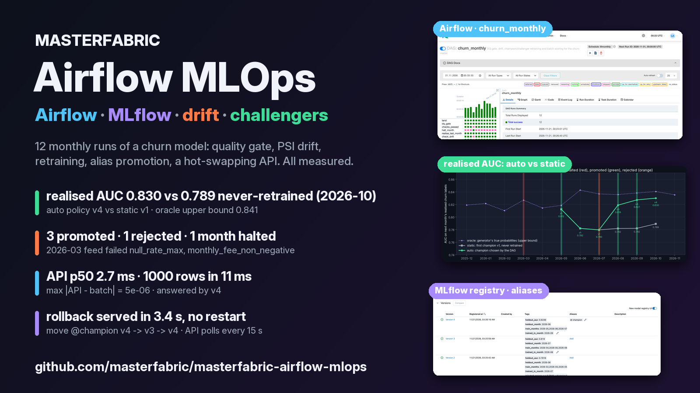</p>

# MasterFabric · Airflow MLOps

**The full lifecycle of a telco churn model, replayed over twelve months on one laptop.** Every month
an Airflow run lands a subscriber snapshot, gates it on data quality, measures how last month's
scores actually did once the churn labels arrived, checks feature drift against the live model's
training data, and decides whether to retrain. A challenger is promoted only if it beats the champion
on the same unseen month. Promotion is an MLflow registry alias, and a FastAPI service follows that
alias without a restart. Evidently reports drift and realised quality every month, Feast serves the
same features to training (point-in-time) and to the API (online), and a new champion goes live through
a sticky canary with guardrails before it replaces the old one.

The year is not quiet on purpose. The 2026-03 feed arrives broken. A competitor's 5G offer changes who
churns from 2026-06 on, and a new tariff appears in 2026-07. The question this repo answers with
numbers: **does retraining on evidence beat a model that is never retrained, and by how much?**

All numbers below come from runs on an Apple M4 Pro (24 GB) with Docker through Colima (6 vCPU, 10 GB).
They are read from [`docs/results/`](docs/results); none are estimates.

| | Measured |
|---|---|
| Backfill | 12 monthly runs (2025-12 → 2026-11), all successful · 60,000 → 66,274 subscribers · 1.2–8.4 s of task time per month |
| Data-quality gate | 11 rules a month · **2026-03 halted** (`null_rate_max`, `monthly_fee_non_negative`), excluded from all training |
| Decisions | v1 promoted (2026-05) · v2 **rejected** (2026-07, lost by 0.0003 AUC) · v3 promoted (2026-08, decay + drift) · v4 promoted (2026-09, drift) |
| Realised AUC, 2026-10 | auto policy (v4) **0.830** · never retrained (v1) **0.789** · oracle upper bound 0.841 |
| Top-decile lift, 2026-10 | auto **4.98** · never retrained 4.63 |
| Drift signal | PSI of `plan` **0.3151** vs v1's data when `postpaid_5g` appeared (trigger: 0.25) |
| Online API | p50 **2.67 ms**, p95 2.93 ms per subscriber · 1,000 rows in 11.4 ms · max diff to batch scores 5.0e-6 |
| Rollback | `@champion` v4 → v3 served after **3.41 s**, back to v4 after 15.27 s (15 s poll), no restart |
| Evidently vs in-house PSI | default detector flags 3–7 of 16 columns in **all 6** monitored months; PSI > 0.25 trigger agrees in 5/6 · realised AUC identical (Δ 0.0) |
| Feast point-in-time | 0 of 194,913 training rows differ from the hand-written join · a naive latest join leaves **all 11,179 churners** without features |
| Feast online | equals offline for 1,000 subscribers · HTTP fetch p50 **1.1 ms** (1 id), 6.1 ms (100 ids) |
| Canary | shuffled-label v6 **rolled back at 5 %** (Spearman −0.088) · v5 passed 5/25/50 %, paired ΔAUC −0.0007 [−0.0031, +0.0016] → **promoted** |

---

## Contents

[Why](#why-this-lab) · [Architecture](#architecture) · [The monthly decision](#the-monthly-decision) ·
[Results](#results) · [Monitoring, features and rollout](#monitoring-features-and-rollout) · [Screenshots](#what-it-looks-like) · [Quickstart](#quickstart) ·
[Walkthrough](#walkthrough) · [Enterprise mapping](#enterprise-mapping) · [Design decisions](#design-decisions) ·
[Limitations](#limitations) · [Roadmap](#roadmap) · [License](#license)

## Why this lab

Most churn notebooks stop at a test-set AUC. In production the hard parts are elsewhere:

- **Labels are late.** A score made in July is judged in August. Any monitoring that waits for labels
  is a month behind, so input drift has to be watched as well.
- **Feeds break.** A billing migration that writes negative fees should stop the month, not quietly
  shift the retention list.
- **New models are not automatically better.** A challenger trained on a regime change can lose to the
  incumbent on next month's data. The promotion rule has to say so, and keep the evidence.
- **Serving has to follow the registry.** Batch scores for CRM and online scores for the call centre
  must come from the same version, and rollback must take seconds.

This repo implements each of those with standard open-source parts (Airflow, MLflow, PostgreSQL, an
S3 store, FastAPI). It then measures the outcome against two references: a model that is never
retrained, and the generator's own churn probabilities as an upper bound.

## Architecture

<p align="center">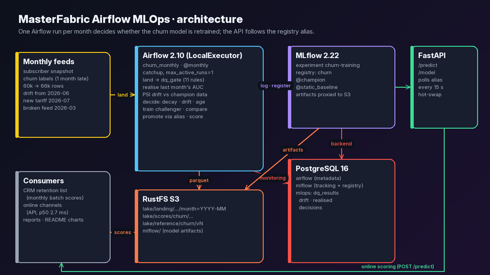</p>
<p align="center"><sub><b>Figure 1.</b> Services and data paths. Everything binds to 127.0.0.1; the monitoring tables live in their own database next to Airflow's and MLflow's.</sub></p>

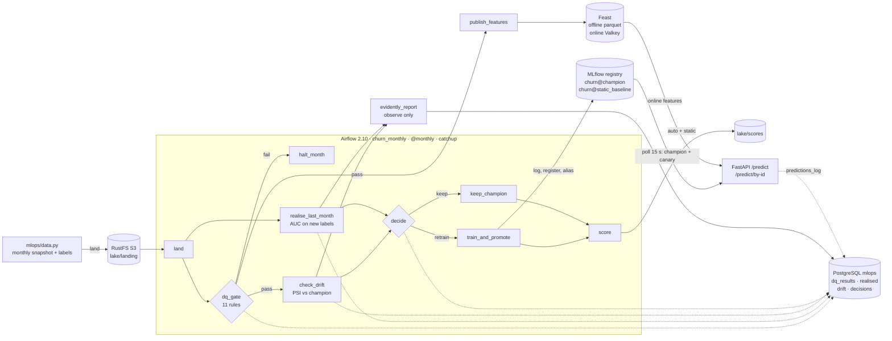

| Component | Version | Role |
|---|---|---|
| Apache Airflow | 2.10.5, LocalExecutor | Monthly DAG, branching, catchup backfill, retries |
| MLflow | 2.22.0 (`--serve-artifacts`) | Experiment `churn-training`, registry `churn` with aliases |
| PostgreSQL | 16 | Airflow metadata, MLflow backend, `mlops` monitoring tables |
| RustFS | 1.0.6 | S3-compatible store: landing data, scores, reference samples, model artefacts |
| scikit-learn | 1.6.1 | `HistGradientBoostingClassifier` behind a one-hot encoder |
| FastAPI | 0.115 on Python 3.12 | Online scoring that follows `@champion`, sticky `@canary` with shadow scoring |
| Feast | 0.68.0 (file offline store, Valkey 8.1 online store) | Point-in-time training frames, online features, feature server and UI |
| Evidently | 0.7.23 | Monthly drift and quality reports, workspace UI |

### The simulated year

[`mlops/data.py`](mlops/data.py) is the source system: a deterministic generator of a growing
subscriber base (60,000 in 2025-12, about +1% a month) with 16 features from CRM, billing and network
KPIs. It knows each subscriber's true churn probability. Labels for month *m* are released in month
*m+1*.

| Month | What happens |
|---|---|
| 2025-12 → 2026-02 | Stable regime; data usage grows ~2.5% a month and 5G devices spread |
| **2026-03** | Upstream ETL bug: 9% of `data_gb` is null and some fees are negative |
| **2026-06** | Concept drift: a competitor's 5G offer makes heavy data users on 4G devices and price-sensitive subscribers far likelier to leave. The features do not change; their meaning does |
| **2026-07** | New tariff `postpaid_5g`, a category no earlier model has seen |

## The monthly decision

<p align="center">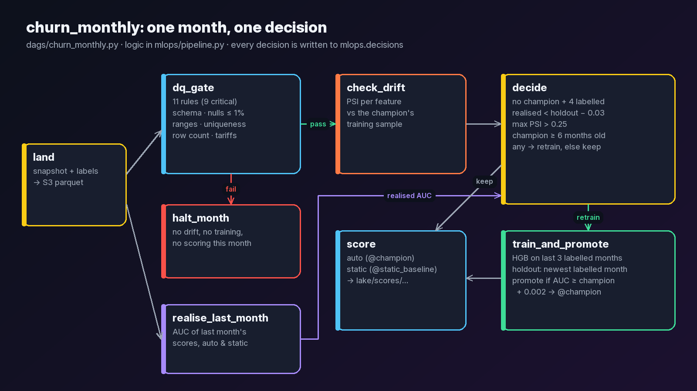</p>
<p align="center"><sub><b>Figure 2.</b> One month, one decision. Every branch writes its evidence to <code>mlops.decisions</code>.</sub></p>

1. **land** writes the snapshot and the previous month's labels to `lake/landing/.../month=YYYY-MM/`.
2. **dq_gate** runs 11 rules: 9 critical and 2 warnings. Any critical failure branches to `halt_month`,
   and that month is never used for training ([ADR 0002](docs/adr/0002-data-quality-gate-halts.md)).
3. **realise_last_month** scores last month's predictions against the labels that just arrived, for
   both policies: `auto` (whatever `@champion` was) and `static` (`@static_baseline`, the first champion).
4. **check_drift** computes PSI per feature (10 quantile bins for numerics, category shares for
   categoricals). The reference is a 20k-row sample of the champion's own training data.
5. **decide** retrains if any trigger holds ([ADR 0004](docs/adr/0004-retrain-triggers.md)):

   | Trigger | Rule |
   |---|---|
   | `no_champion` | no model yet and ≥ 4 labelled months (3 to train, 1 to hold out) |
   | `performance_decay` | last realised AUC < champion's holdout AUC − 0.03 |
   | `data_drift` | max feature PSI > 0.25 |
   | `scheduled` | champion trained ≥ 6 months ago |

6. **train_and_promote** trains on the 3 newest labelled months, holds out the newest one, and scores
   the champion on the same holdout. It promotes only if the challenger wins by at least
   **0.002 AUC** ([ADR 0005](docs/adr/0005-sliding-window-holdout.md)). Losers stay registered with a
   `rejected_reason` tag.
7. **score** writes monthly scores for both policies to `lake/scores/churn/month=.../`.

## Results

### What the DAG decided

<p align="center">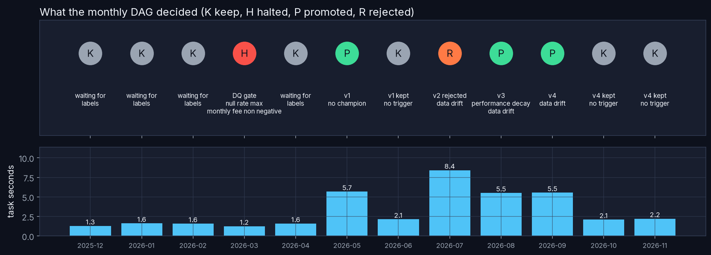</p>
<p align="center"><sub><b>Figure 3.</b> Decisions over the year and the task time of each run (sum of task durations).</sub></p>

| Month | Action | Evidence | Challenger vs champion (holdout AUC) |
|---|---|---|---|
| 2025-12 → 2026-02 | keep | waiting for labels (0–2 of 4 labelled months) | — |
| 2026-03 | **halted** | `null_rate_max`, `monthly_fee_non_negative` | — |
| 2026-04 | keep | waiting for labels (3 of 4; March does not count) | — |
| 2026-05 | **promoted v1** | `no_champion` | 0.8098 (holdout 2026-04) |
| 2026-06 | keep | PSI max 0.19 (`contract_months_left`) | — |
| 2026-07 | **rejected v2** | `data_drift`: PSI `plan` 0.3151 | 0.7816 vs 0.7819 |
| 2026-08 | **promoted v3** | `performance_decay` (realised 0.7796 vs 0.8098) + `data_drift` (PSI 0.2983) | 0.8190 vs 0.7796 |
| 2026-09 | **promoted v4** | `data_drift`: PSI `plan` 0.2776 vs v3's data | 0.8249 vs 0.8188 |
| 2026-10, 2026-11 | keep | no trigger (max PSI 0.08, 0.12) | — |

The 2026-07 rejection is the interesting one. The challenger was trained on 2026-02, 04 and 05, all
before the 5G offer, and held out on 2026-06, the first drifted month. It had no better information
than the champion, and the rule caught that. One month later, with the new regime in its training
window, v3 won by 0.039.

### Realised performance: retraining on evidence vs never retraining

<p align="center">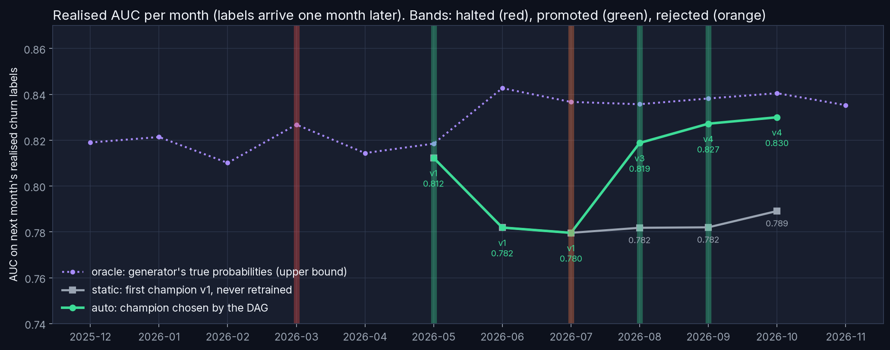</p>
<p align="center"><sub><b>Figure 4.</b> AUC on labels that arrived a month after the scores. The oracle line is the generator's true churn probability scored the same way: no model can beat it on this data.</sub></p>

| Scored month | Auto (version) | Static v1 | Oracle | Auto lift@10% | Static lift@10% | Churn rate |
|---|---|---|---|---|---|---|
| 2026-05 | 0.8123 (v1) | 0.8123 | 0.8185 | 5.20 | 5.20 | 3.78% |
| 2026-06 | 0.7819 (v1) | 0.7819 | 0.8427 | 4.29 | 4.29 | 6.24% |
| 2026-07 | 0.7796 (v1) | 0.7796 | 0.8367 | 4.30 | 4.30 | 5.80% |
| 2026-08 | **0.8188 (v3)** | 0.7818 | 0.8357 | 4.78 | 4.37 | 5.88% |
| 2026-09 | **0.8272 (v4)** | 0.7820 | 0.8382 | 5.00 | 4.48 | 5.53% |
| 2026-10 | **0.8300 (v4)** | 0.7891 | 0.8405 | 4.98 | 4.63 | 5.44% |

Read it as: the concept drift in 2026-06 costs v1 about 0.03 AUC overnight, and the gap to the oracle
grows from 0.006 to 0.06. Two retrains later the auto policy is back within 0.011 of the oracle, while
the never-retrained model stays 0.05 below. 2026-11 scores exist but cannot be judged until December's
labels arrive.

### Drift

<p align="center">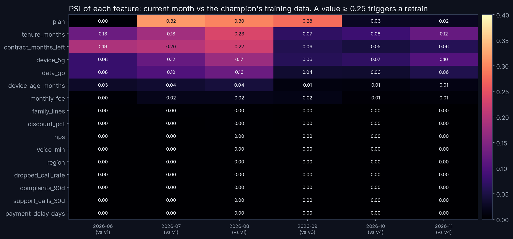</p>
<p align="center"><sub><b>Figure 5.</b> PSI per feature against the current champion's training sample. The reference changes when a new champion is promoted (v1 → v3 → v4).</sub></p>

`plan` crosses the 0.25 trigger three months running as `postpaid_5g` grows. Once v4 is trained on
months that already contain the new tariff, it drops to 0.03. `tenure_months` and
`contract_months_left` drift too, but stay under the trigger. The concept drift in 2026-06 shows up
here only weakly (max PSI 0.19). That is why the `performance_decay` trigger exists: in 2026-08 it is
what fired, together with drift.

### Registry

<p align="center">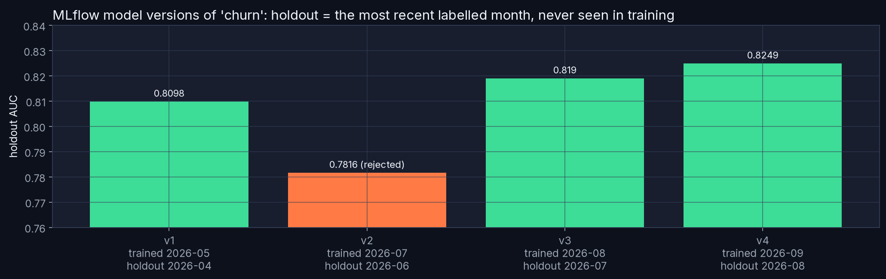</p>
<p align="center"><sub><b>Figure 6.</b> Every version registered by the DAG, with its holdout month. v2 lost and carries <code>rejected_reason</code>.</sub></p>

| Version | Trained in | Train months | Holdout | Holdout AUC | Alias at the end |
|---|---|---|---|---|---|
| v1 | 2026-05 | 2025-12, 2026-01, 2026-02 | 2026-04 | 0.8098 | `@static_baseline` |
| v2 | 2026-07 | 2026-02, 2026-04, 2026-05 | 2026-06 | 0.7816 | (rejected) |
| v3 | 2026-08 | 2026-04, 2026-05, 2026-06 | 2026-07 | 0.8190 | |
| v4 | 2026-09 | 2026-05, 2026-06, 2026-07 | 2026-08 | 0.8249 | (champion until the canary rollout) |
| v5 | rollout | 2026-06, 2026-07, 2026-08 | 2026-09 | 0.8297 | `@champion` (promoted by the canary, ADR 0007) |
| v6 | rollout | same, labels shuffled | 2026-09 | 0.4414 | (rolled back at 5 %, `rollback_reason`) |

v1–v4 were registered by the DAG; v5 and v6 by `scripts/train_candidate.py` for the rollout experiment.

### Online serving

From [`docs/results/api_demo.json`](docs/results/api_demo.json) and
[`hotswap_demo.json`](docs/results/hotswap_demo.json). Both are measured from inside the Docker network,
with 1,000 real subscribers from the 2026-11 snapshot.

| Measurement | Result |
|---|---|
| Model answering | `churn` v4 via `@champion` (measured before the canary rollout promoted v5) |
| Single-subscriber request (n = 200) | p50 **2.67 ms**, p95 2.93 ms |
| One request with 1,000 subscribers | **11.4 ms** |
| Max absolute difference vs the DAG's batch scores | 5.0e-6 |
| Rollback: move `@champion` to v3 | served after **3.41 s** |
| Restore: move `@champion` back to v4 | served after 15.27 s (one 15 s poll interval) |

MLflow's signature enforcement is on in the API. It caught a real bug during the build: the request
schema declared `discount_pct` as float, but the trained signature says integer.

## Monitoring, features and rollout

Three additions run in the compose profile `monitoring` (started by `make up`): Evidently for drift and
quality reports, Feast for features, and a canary in the scoring API. None of them changes how the DAG
decides; the canary changes how a new champion reaches traffic.

<p align="center">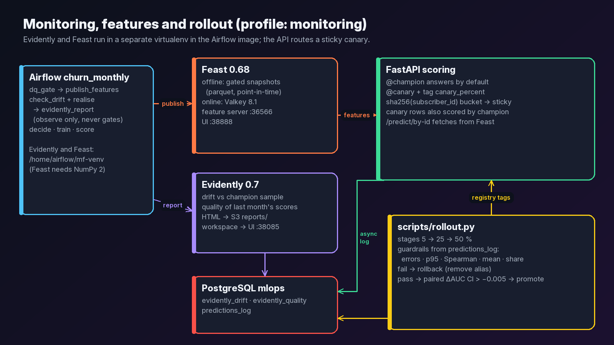</p>
<p align="center"><sub><b>Figure 7.</b> Where the new pieces sit. Evidently and Feast run in a separate virtualenv in the Airflow image because Feast 0.68 needs NumPy 2 and Airflow 2.10.5 pins 1.26.</sub></p>

### Evidently: a second opinion on drift, not a new trigger

`evidently_report` runs every month after `check_drift` and `realise_last_month` and is not upstream of
`decide` ([ADR 0008](docs/adr/0008-evidently-observes-psi-decides.md)). Numbers from
[`docs/results/evidently.json`](docs/results/evidently.json), 2026-06..11 (months with a champion):

<p align="center">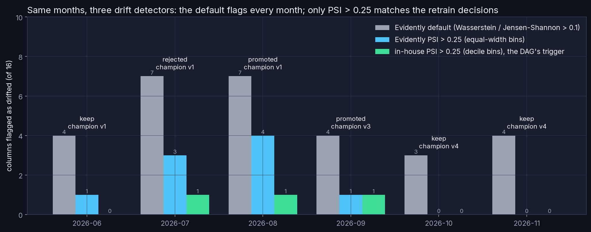</p>
<p align="center"><sub><b>Figure 8.</b> Columns flagged per month by three detectors on the same data. The default detector would have retrained every month, including 2026-10 and 2026-11 where nothing was wrong.</sub></p>

| Month | Reference | DAG decision | Evidently default: drifted columns | Evidently PSI > 0.25 | In-house PSI > 0.25 | In-house max PSI |
|---|---|---|---|---|---|---|
| 2026-06 | v1 | keep | 4 | device_age_months | – | contract_months_left 0.192 |
| 2026-07 | v1 | rejected | 7 | device_age_months, plan, tenure_months | plan | plan 0.315 |
| 2026-08 | v1 | promoted | 7 | contract_months_left, device_age_months, plan, tenure_months | plan | plan 0.298 |
| 2026-09 | v3 | promoted | 4 | plan | plan | plan 0.278 |
| 2026-10 | v4 | keep | 3 | – | – | tenure_months 0.082 |
| 2026-11 | v4 | keep | 4 | – | – | tenure_months 0.122 |

- The PSI trigger (any column > 0.25) agrees in **5 of 6** months. Evidently's PSI and the in-house PSI
  match to 0.0008 on categorical columns and differ by up to
  0.3274 on numeric ones: Evidently bins on equal widths, the in-house
  PSI on reference deciles, and long-tailed integer columns (`device_age_months`, `tenure_months`) move most.
- Realised ROC AUC computed by Evidently equals the DAG's value in every month (2026-05 0.8123 · 2026-06 0.7819 · 2026-07 0.7796 · 2026-08 0.8188 · 2026-09 0.8272 · 2026-10 0.8300).
- One drift report takes 0.99 s; the HTML goes to
  `s3://lake/reports/evidently/` and a run stamped with its business month goes to the Evidently UI.

### Feast: the same features for training and for the API

`publish_features` runs after `checks_passed`: it exports the gated snapshots to the offline store,
applies `feature_repo/` and materialises the month into Valkey
([ADR 0009](docs/adr/0009-feast-point-in-time-features.md)). Numbers from
[`docs/results/feast.json`](docs/results/feast.json) and [`api_byid.json`](docs/results/api_byid.json):

<p align="center">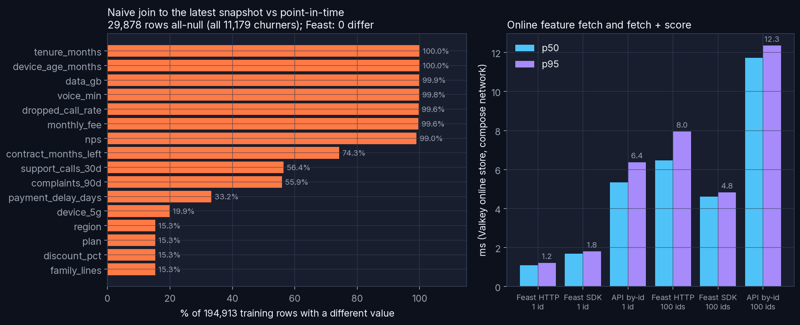</p>
<p align="center"><sub><b>Figure 9.</b> Left: what a join to the latest snapshot would have trained on. Right: online fetch and fetch-plus-score latency over the compose network.</sub></p>

| Check | Result |
|---|---|
| Point-in-time frame for 2026-07..09 vs the DAG's own join | **0 of 194,913 rows differ** · Feast 3.73 s, direct join 0.09 s |
| Naive join of the same labels to the 2026-11 snapshot | every row has ≥ 1 wrong-time value · 29,878 rows (15.3%) get no features, including all 11,179 churners |
| Halted month 2026-03 (not exported) | served from 2026-02 within the 31-day TTL · 2,858 new subscribers get no features |
| Online vs offline, 1,000 sampled subscribers | **0 differences** |
| Feast HTTP fetch, 1 / 100 ids | p50 1.1 / 6.47 ms · p95 1.22 / 7.95 ms |
| Feast SDK fetch, 1 / 100 ids | p50 1.69 / 4.61 ms · p95 1.8 / 4.83 ms |
| `/predict/by-id` vs `/predict` with features in the body, 1 id | p50 5.35 vs 2.9 ms |
| same, 100 ids | p50 11.73 vs 4.58 ms · scores identical on 2,000 subscribers |

### Canary and A/B rollout

The API resolves `@canary` next to `@champion`; the registered-model tag `canary_percent` sets the share.
Subscribers are routed by `sha256(subscriber_id)`, so a subscriber keeps its variant and raising the share
only adds subscribers to the canary. Canary requests are also scored by the champion (shadow), and every
scored subscriber goes to `predictions_log` asynchronously. `scripts/rollout.py` replays the 2026-10
snapshot (66,274 subscribers, the latest month with labels) at 5, 25 and 50 % and checks the
guardrails of [ADR 0007](docs/adr/0007-canary-rollout-guardrails.md), which were committed before the run.

<p align="center">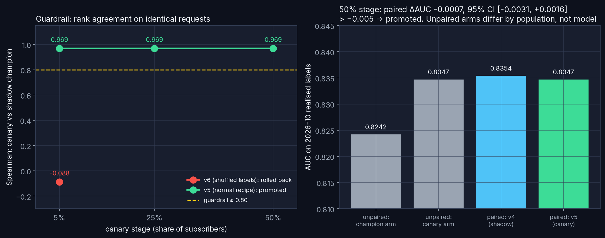</p>
<p align="center"><sub><b>Figure 10.</b> Left: the rank guardrail stops the shuffled-label model at 5 %. Right: the unpaired arms differ by population; the paired comparison on the same subscribers is what decides.</sub></p>

| Candidate | Stage | Routed | Canary rows | Errors | p95 ms canary / champion | Spearman vs shadow | Mean prob canary / shadow | Sticky | Guardrails |
|---|---|---|---|---|---|---|---|---|---|
| v6 | 5 % | 5.10 % | 3,381 | 0.0% | 6.4 / 28.7 | -0.088 | 0.0598 / 0.0539 | yes | FAIL |
| v5 | 5 % | 5.10 % | 3,381 | 0.0% | 22.2 / 24.1 | 0.969 | 0.0598 / 0.0539 | yes | pass |
| v5 | 25 % | 25.20 % | 16,698 | 0.0% | 21.7 / 24.0 | 0.969 | 0.0587 / 0.0529 | yes | pass |
| v5 | 50 % | 50.05 % | 33,173 | 0.0% | 21.6 / 23.6 | 0.969 | 0.0587 / 0.0530 | yes | pass |

- **v6** (trained on shuffled labels, holdout AUC 0.44) was rolled back at 5 % on rank agreement; the
  API reported the canary gone 2.89 s after the alias was removed. Its mean prediction was
  only 11 % above the champion's, so a mean-only guardrail would have passed it.
- **v5** (the normal recipe, one month newer) passed all stages. On the 33,173 canary subscribers of
  the 50 % stage (1,867 churners), AUC 0.8347 vs the champion's 0.8354
  on the same rows: ΔAUC -0.0007, 95 % bootstrap CI [-0.0031, +0.0016]. The
  lower bound is above the pre-declared −0.005, so v5 was promoted and answered 7.79 s later.
  It is non-inferior, not better: the rollout replaced v4 with a model trained on one more month.
- Latency here is the model's own inference time inside a 50-subscriber request, with 4 concurrent
  clients on the laptop; v5 and v4 are the same model family, so they should be close, and they are.

## What it looks like

<p align="center">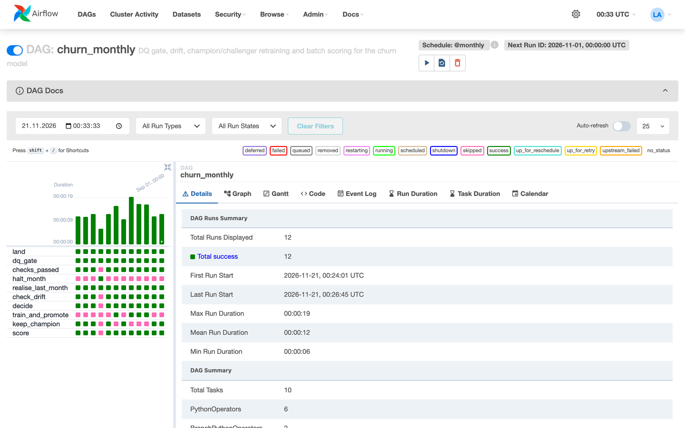</p>
<p align="center"><sub><b>Figure 11.</b> Airflow grid of <code>churn_monthly</code> after the backfill: 12 runs, with skipped branches (pink) where the DAG kept the champion or halted.</sub></p>

<p align="center">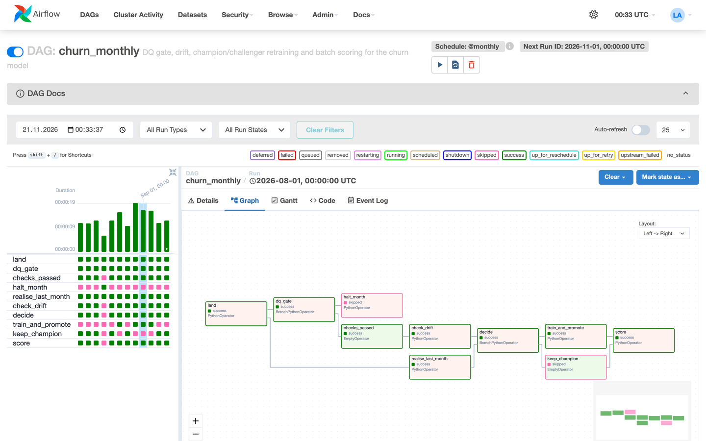</p>
<p align="center"><sub><b>Figure 12.</b> Graph of the 2026-08 run: the gate passed, <code>decide</code> took the retrain branch and v3 was promoted.</sub></p>

<p align="center">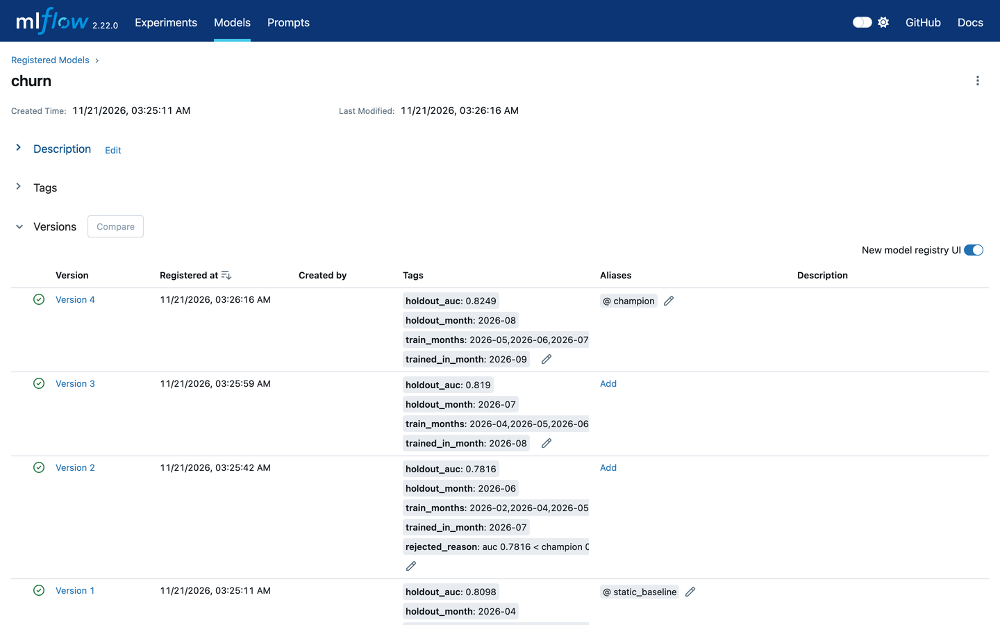</p>
<p align="center"><sub><b>Figure 13.</b> MLflow registry at the end of the backfill: v4 is <code>@champion</code> and v1 is <code>@static_baseline</code> (Figure 21 shows it after the canary rollout). Holdout metrics and the rejection reason are tags.</sub></p>

<p align="center">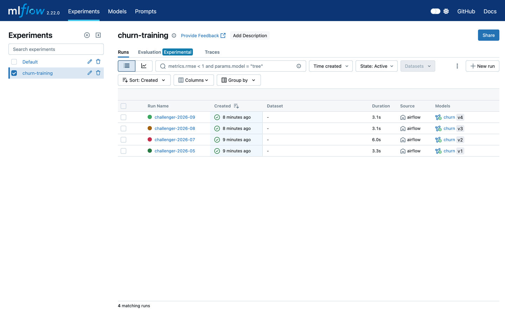</p>
<p align="center"><sub><b>Figure 14.</b> One MLflow run per challenger, with parameters, holdout metrics and the champion's AUC on the same holdout.</sub></p>

<p align="center">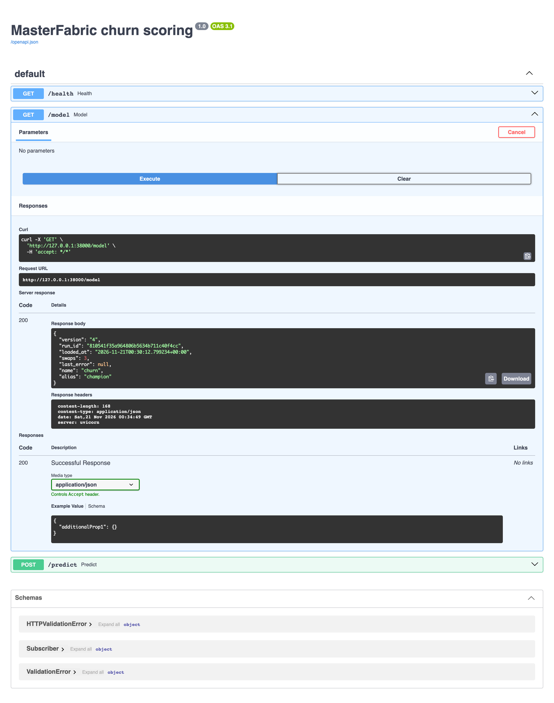</p>
<p align="center"><sub><b>Figure 15.</b> The scoring API reports which version it serves, when it loaded it and how many swaps it has made.</sub></p>

<p align="center">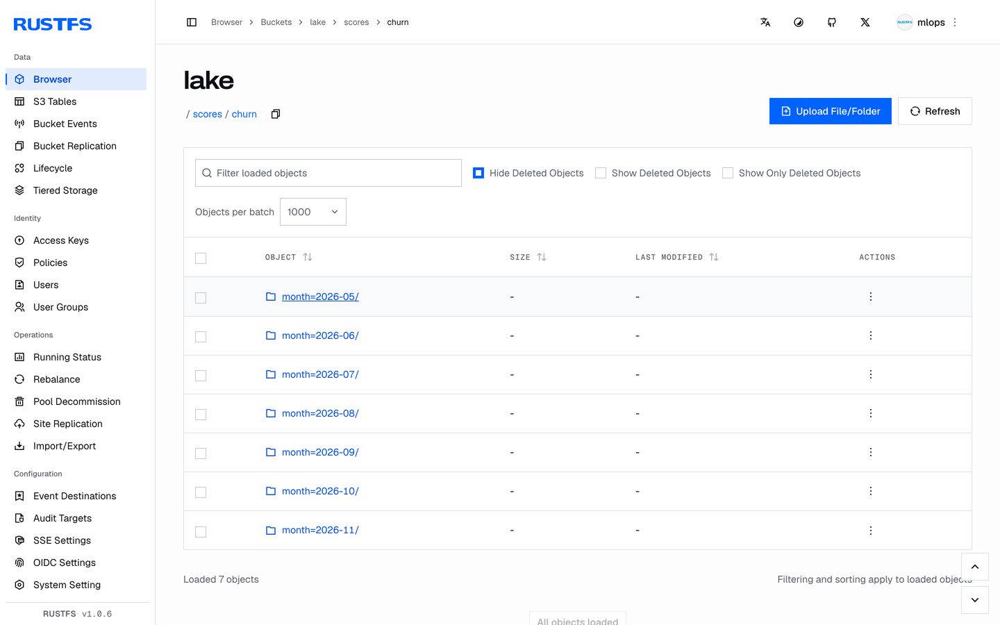</p>
<p align="center"><sub><b>Figure 16.</b> Monthly score partitions in the S3 store, one per month from 2026-05, the first month with a champion. Each holds <code>auto.parquet</code> and <code>static.parquet</code>.</sub></p>

<p align="center">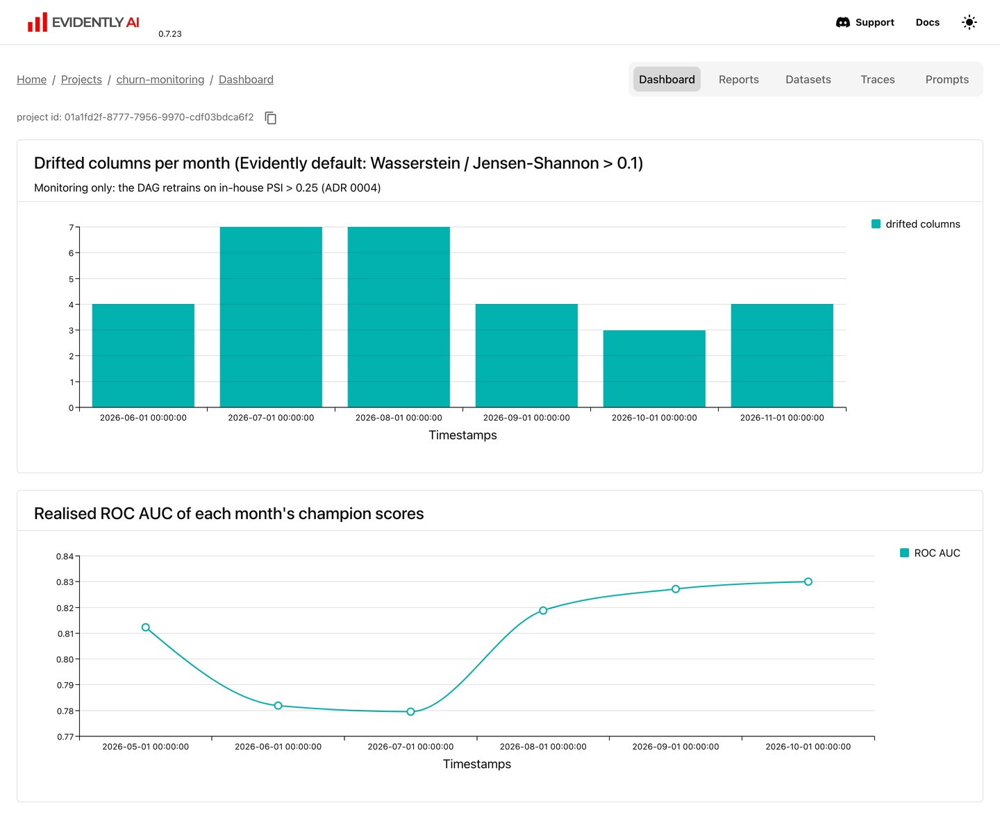</p>
<p align="center"><sub><b>Figure 17.</b> Evidently UI, project <code>churn-monitoring</code>: drifted columns per month (default detector) and the realised ROC AUC of each month's scores. Runs are stamped with their business month.</sub></p>

<p align="center">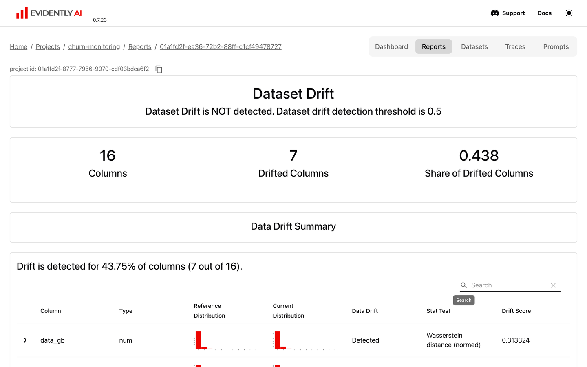</p>
<p align="center"><sub><b>Figure 18.</b> The 2026-07 drift report against v1's training sample: 7 of 16 columns flagged by the default detector, while the DAG's PSI rule flagged only <code>plan</code>.</sub></p>

<p align="center">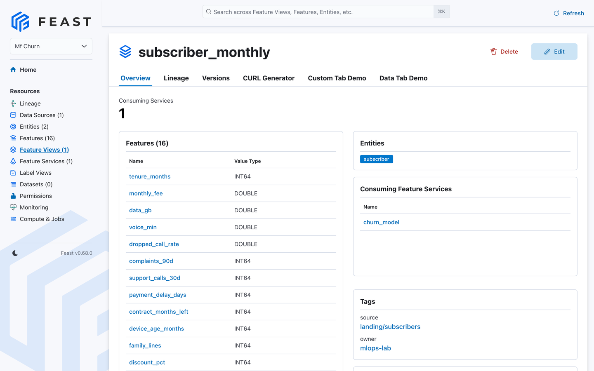</p>
<p align="center"><sub><b>Figure 19.</b> Feast UI: feature view <code>subscriber_monthly</code> (16 features, entity <code>subscriber</code>), consumed by the feature service <code>churn_model</code>.</sub></p>

<p align="center">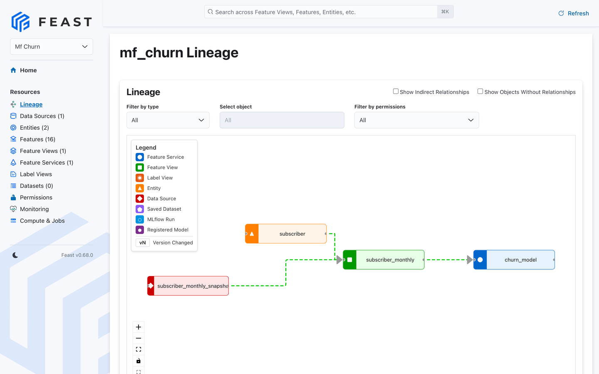</p>
<p align="center"><sub><b>Figure 20.</b> Feast lineage: gated snapshot source → <code>subscriber_monthly</code> → <code>churn_model</code>.</sub></p>

<p align="center">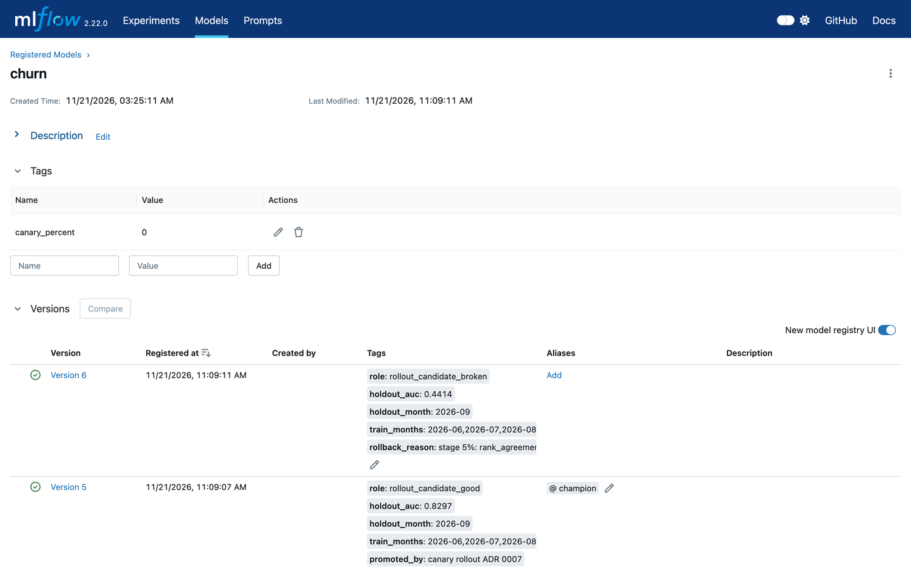</p>
<p align="center"><sub><b>Figure 21.</b> The registry after the rollout: v5 holds <code>@champion</code> with <code>promoted_by</code>, v6 carries <code>rollback_reason</code>, and the model tag <code>canary_percent</code> is back at 0.</sub></p>

<p align="center">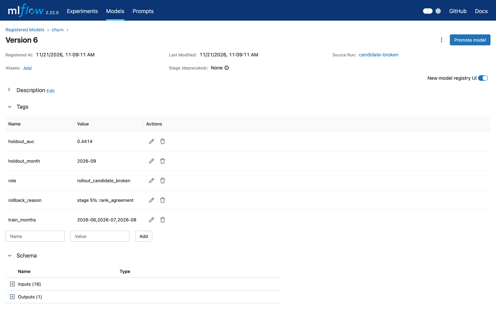</p>
<p align="center"><sub><b>Figure 22.</b> Version 6: rolled back at the 5 % stage on the rank-agreement guardrail.</sub></p>

<p align="center">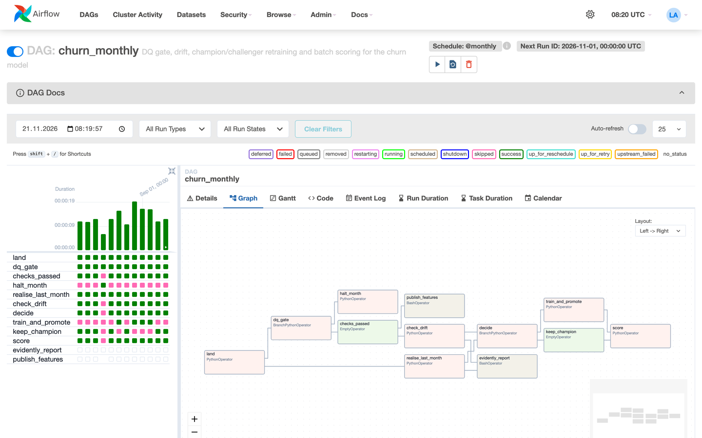</p>
<p align="center"><sub><b>Figure 23.</b> The DAG with <code>publish_features</code> and <code>evidently_report</code>. Their grid cells are empty because the 12 existing months ran them with <code>airflow tasks test</code> (no run state); a fresh backfill runs them inside the DAG.</sub></p>

## Quickstart

Requirements: Docker with Compose v2 (Docker Desktop, Colima or Podman), about 7 GB of free memory, and
`make`. Python on the host is needed only to regenerate the images.

```bash
git clone https://github.com/masterfabric/masterfabric-airflow-mlops.git
cd masterfabric-airflow-mlops
make env        # creates .env from .env.example (lab-only credentials)
make up         # PostgreSQL, RustFS, MLflow, Airflow, API, Feast + Valkey, Evidently UI; first build ~5 min
make test       # 14 unit tests inside the Airflow image
make backfill   # unpause churn_monthly; the 12 months run in order (~10 min)
make status     # run states
make report     # docs/results/backfill.json
make demo       # API latency/parity and the rollback measurement
make monitoring # only for months that ran before the Evidently/Feast tasks existed; then the summaries
make candidates # register a normal and a shuffled-label candidate
make rollout VERSIONS="6 5"   # canary 5/25/50 % with guardrails; may move @champion (ADR 0007)
make down
```

| UI | URL | Login |
|---|---|---|
| Airflow | http://127.0.0.1:38080 | `AIRFLOW_ADMIN_USER` / `AIRFLOW_ADMIN_PASSWORD` from `.env` |
| MLflow | http://127.0.0.1:35000 | none (lab) |
| Scoring API | http://127.0.0.1:38000/docs | none (lab) |
| RustFS console | http://127.0.0.1:39001 | `S3_ACCESS_KEY` / `S3_SECRET_KEY` from `.env` |
| Feast UI | http://127.0.0.1:38888 | none (lab) |
| Feast feature server | http://127.0.0.1:36566 | none (lab) |
| Evidently UI | http://127.0.0.1:38085 | none (lab) |

Regenerate the images from the results:

```bash
uv venv -p 3.12 .venv && uv pip install -p .venv/bin/python playwright pillow matplotlib numpy pandas
.venv/bin/python -m playwright install chromium
cd scripts && ../.venv/bin/python make_charts.py && ../.venv/bin/python make_diagrams.py \
  && ../.venv/bin/python screenshots.py && ../.venv/bin/python make_hero.py \
  && ../.venv/bin/python make_monitoring_assets.py && ../.venv/bin/python screenshots_monitoring.py
```

## Walkthrough

1. **Watch a broken month stop.** In Airflow, open the 2026-03 run: `dq_gate` branched to
   `halt_month`, and drift, training and scoring were skipped. `SELECT * FROM dq_results WHERE month='2026-03'`
   in the `mlops` database lists the failing rules with their observed values.
2. **See a challenger lose.** In MLflow, open run `challenger-2026-07`: its holdout AUC is 0.7816, and
   `champion_holdout_auc` on the same month is 0.7819. The registry shows v2 with `rejected_reason`.
3. **Follow a promotion to the API.** Call `GET /model` on the API. It reports the champion (v5 after
   the canary rollout, v4 at the end of the backfill), the `run_id`, any canary and its share, and the
   number of swaps it made.
4. **Roll back.** Run `make demo`, or move the alias yourself in the MLflow UI (previous version →
   Aliases → `champion`). Within 15 s, `/model` reports it and `/predict` answers with it.
5. **Ask why.** `SELECT month, action, reasons, details FROM decisions ORDER BY month` gives the full
   audit trail: triggers, PSI feature, realised vs validation AUC, and the challenger and champion AUCs.
6. **Compare drift detectors.** Open the Evidently UI, project `churn-monitoring`, and the 2026-07 drift
   report; then `SELECT month, drifted_columns, psi_method, in_house_psi FROM evidently_drift`.
7. **Score by id.** `POST /predict/by-id` with `{"subscriber_ids": ["S00000001"]}`: the API fetches the
   16 features from the Feast feature server and returns `feature_fetch_ms` with the score.
8. **Run a canary yourself.** In MLflow, give a version the alias `canary` and set the model tag
   `canary_percent` to 10. Within 15 s `/model` shows it; `SELECT variant, count(*) FROM predictions_log
   GROUP BY 1` shows the split. Remove the alias to roll back.

## Enterprise mapping

<p align="center">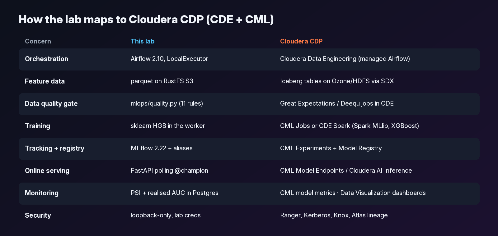</p>
<p align="center"><sub><b>Figure 24.</b> Each concern in the lab and its Cloudera CDP counterpart.</sub></p>

The DAG and the `mlops` package are written to move to a Cloudera estate with few changes:

- **CDE** runs managed Airflow, so `churn_monthly.py` can be deployed as is. The heavy steps (`land`,
  training) become `CDEJobRunOperator` tasks that run Spark on Iceberg tables instead of pandas on parquet.
- **CML** provides an MLflow-compatible experiment tracker and model registry, so the alias contract
  carries over. CML Model Endpoints (or Cloudera AI Inference) replace the FastAPI container.
- **SDX** (Ranger, Atlas) supplies what the lab leaves out on purpose: column-level access to
  subscriber data, lineage from the landing tables to the scores, and an audit of who moved an alias.

## Design decisions

| ADR | Decision |
|---|---|
| [0001](docs/adr/0001-airflow-monthly-catchup.md) | One Airflow run per month, backfilled in order with catchup |
| [0002](docs/adr/0002-data-quality-gate-halts.md) | A blocking data-quality gate that halts the month |
| [0003](docs/adr/0003-mlflow-registry-aliases.md) | MLflow registry aliases as the deployment contract |
| [0004](docs/adr/0004-retrain-triggers.md) | Retrain on evidence: decay, drift or age |
| [0005](docs/adr/0005-sliding-window-holdout.md) | Sliding 3-month window, newest labelled month as holdout, minimum gain |
| [0006](docs/adr/0006-serving-hot-swap.md) | Online API resolves `@champion` and hot-swaps without a restart |
| [0007](docs/adr/0007-canary-rollout-guardrails.md) | Champion changes go through a sticky canary with pre-declared guardrails |
| [0008](docs/adr/0008-evidently-observes-psi-decides.md) | Evidently reports drift and quality; the in-house PSI still decides |
| [0009](docs/adr/0009-feast-point-in-time-features.md) | Feast for point-in-time training frames and an online store |

## Limitations

- **Synthetic data.** The subscriber base, the drift and the broken feed come from a generator, and
  the generator decides how much retraining can help. The oracle line shows that ceiling. The
  *mechanics* (gate, triggers, promotion, serving) are what transfer, not the exact AUCs.
- **One seed, one year.** The results come from one deterministic run (seed 42). A different seed moves
  the AUCs by small amounts; the thresholds (PSI 0.25, decay 0.03, gain 0.002) were set from domain
  defaults, not tuned on this run.
- **The last month was triggered by hand.** Under `@monthly`, the 2026-11 run is only due in December.
  It was triggered with the same logical date (`airflow dags trigger -e 2026-11-01`).
- **Training runs inside the Airflow worker.** That is fine for 190k rows and seconds of training. At
  operator scale, training belongs in a separate job (CDE Spark, CML Jobs, KubernetesPodOperator).
- **pandas and parquet, not Spark and Iceberg.** The lake and Spark/Iceberg path is shown in
  [masterfabric-lakehouse-lab](https://github.com/masterfabric/masterfabric-lakehouse-lab). This repo
  stays small so the lifecycle logic is easy to read.
- **Polling, not events.** The API notices an alias change within 15 s. OSS MLflow 2.22 has no registry
  webhooks; a production setup would push the change or use the platform's endpoint rollout.
- **Lab security.** Services bind to 127.0.0.1, credentials are lab placeholders from `.env`, MLflow
  and the API have no authentication, and the S3 store is single-node.
- **The canary replays a past month.** Real canary traffic arrives over weeks and its labels a month
  later; here the 2026-10 snapshot is replayed three times in minutes, so the AUC gate runs right after
  the guardrails. Each stage re-sends every subscriber, which also makes the stickiness check possible.
- **One rollout, two candidates.** The guardrail limits were declared before the run (ADR 0007), but they
  were exercised by one obviously broken model and one normal one; a subtler failure (a single shifted
  feature) was not tested.
- **The rollout moved `@champion` outside the DAG.** v5 was promoted by `scripts/rollout.py`; the DAG's
  `decisions` table still ends at v4, and the promotion is recorded in the registry tags and
  `docs/results/rollout.json`.
- **The new DAG tasks ran outside the DAG for the existing months.** `evidently_report` and
  `publish_features` were added after the backfill and run for the 12 months with `airflow tasks test`
  (`scripts/backfill_monitoring.sh`), which records no task state.
- **Evidently numeric PSI is not the DAG's PSI.** It uses equal-width bins; the in-house PSI uses
  reference deciles. They agree on categorical columns and on the trigger in 5 of 6 months, not on
  every numeric value.
- **Feast on files.** The offline store is one parquet file rewritten each month and the registry is a
  local file; that is fine for 700k rows, not for a production feature store. Training still uses the
  hand-written join, which Feast was shown to match.
- **No business metric.** AUC and top-decile lift stand in for retention value. A real evaluation would
  price the offer and measure uplift with a holdout of untreated customers.

## Roadmap

- Uplift modelling with a treatment/control split, so the decision is "who to call", not "who churns".
- Calibration monitoring (Brier score, reliability per decile) next to AUC.
- Let the DAG open the canary itself after `train_and_promote` and close it a month later on the
  realised labels.
- Train from Feast's point-in-time frame and register the feature service version with the model.
- Calibration and per-segment guardrails (plan, region) in the rollout.
- Spark on Iceberg for `land` and training, run as CDE jobs from the same DAG.
- Great Expectations suites generated from `quality.py`, with data docs published per month.

## License

Copyright (c) 2026 MasterFabric. Licensed under the **GNU Affero General Public License v3.0**; see
[LICENSE](LICENSE). [NOTICE](NOTICE) lists the additional attribution terms and the licenses of the
third-party components (Airflow, MLflow, PostgreSQL, RustFS, scikit-learn, FastAPI and others), which
keep their own licenses. See [CONTRIBUTING](CONTRIBUTING.md), [CODE_OF_CONDUCT](CODE_OF_CONDUCT.md) and
[SECURITY](SECURITY.md).
